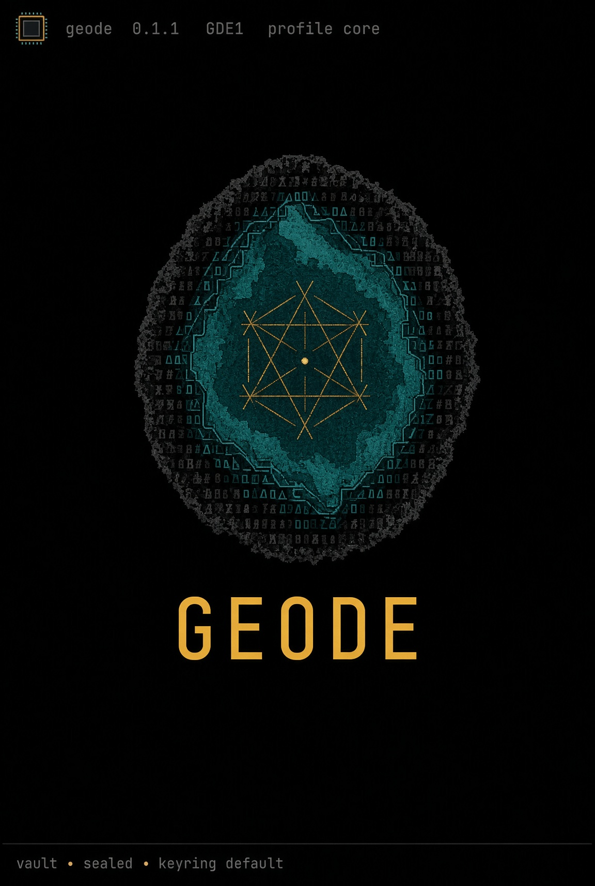

<p align="center">
  <a href="https://github.com/Hedronite/geode">
    
  </a>
</p>

<h1 align="center">Geode</h1>

<p align="center">
  <strong>Stone outside. Structure inside.</strong><br>
  File and directory custody for a shared disk, for people and agents.
</p>

<p align="center">
  <a href="https://github.com/Hedronite/geode/actions/workflows/ci.yml"></a>
  <a href="https://github.com/Hedronite/geode/releases/latest"></a>
  <a href="https://crates.io/crates/geode-grotto"></a>
  <a href="https://crates.io/crates/geode-cli"></a>
  <a href="https://rustup.rs"></a>
  <a href="LICENSE"></a>
</p>

<p align="center">
  <a href="#quick-start">Quick start</a> ·
  <a href="#what-you-get">What you get</a> ·
  <a href="#agents">Agents</a> ·
  <a href="#how-it-works">How it works</a> ·
  <a href="#limits">Limits</a> ·
  <a href="#status">Status</a> ·
  <a href="CHANGELOG.md">Changelog</a> ·
  <a href="#contributing">Contributing</a>
</p>

<p align="center">
  Built by <a href="https://hedronite.com">Hedronite</a>.
</p>

---

Geode seals files and directory trees so people and agents can share a disk without sharing plaintext. Ciphertext lives on the disk. The identity key stays with you. An agent gets a scoped token, never the key.

The on-disk format is **GDE1**, cipher suite **`0x01`**: AEGIS-256-X2, BLAKE3, Argon2id, and HCTR2-256. You work with a vault through the `geode` CLI, the terminal UI, or MCP tools. A build with the `fuse` feature can also mount a vault on Linux.

| | |
|---|---|
| Format | GDE1, suite `0x01` |
| Binary | `geode` ([`geode-cli`](crates/geode-cli)) |
| Library | [`geode-grotto`](crates/geode-core) (Rust import `geode_grotto`) |
| Version | **1.2.1** · [release](https://github.com/Hedronite/geode/releases/tag/v1.2.1) · [changelog](CHANGELOG.md) |
| Platforms | Linux and macOS |
| Rust | 1.89 |
| License | [Apache-2.0](LICENSE) |

## Quick start

You need Rust **1.89** or newer. Install the CLI from crates.io, or run it from a clone.

```sh
cargo install geode-cli
# from a clone: cargo run -p geode-cli --
```

Generate a key, create a vault, seal one file, and read it back:

```sh
mkdir /tmp/geode-demo && cd /tmp/geode-demo

geode keygen ./demo.gkey
geode --key ./demo.gkey vault init ./vault.geode
printf 'stone outside\n' > note.txt
geode --key ./demo.gkey seal note.txt ./vault.geode
geode --key ./demo.gkey list ./vault.geode
geode --key ./demo.gkey cat ./vault.geode note.txt
```

Pass `--key` or set `GEODE_KEY_FILE`, unless a keyring default or `~/.config/hedronite/geode/default.gkey` exists (`$XDG_CONFIG_HOME` is honored). `geode keygen` with no path writes `./secret.gkey` and warns you to move it. Key files are mode `0600`. Never commit one; `*.gkey` belongs in `.gitignore`.

Where a seal lands in the vault:

- A file is stored under its basename, so `seal ./docs/note.txt` stores `note.txt`. Pass `--as api/svc-a.txt` to pick the vault path; `--as` takes one file, not a directory.
- A directory keeps paths relative to that directory: `seal ./site` stores `site/index.html` as `index.html`.
- Sealing a path that is already in the vault replaces it, exits 0, and prints `warning: replacing existing vault path PATH` on stderr. With `--seal-names`, `PATH` is the stored ciphertext name.

Run `geode --help`, or `geode <command> --help`, for the full command list.

## What you get

| | Plain shared disk | Geode |
|---|---|---|
| Bytes on disk | Plaintext files | GDE1 objects: chunked AEAD under a merklized content root |
| Filenames | Visible | Plaintext by default; `seal --seal-names` stores ciphertext names |
| People | Any editor | The `geode` CLI and the terminal UI (`geode tui`) |
| Agents | The same key, or raw files | Scoped `GTOK` tokens and MCP tools; see [Agents](#agents) |
| Integrity | Hope | `geode verify`: full, `--cheap`, or `--sample P`. Exit 2 means an authentication or integrity failure |
| History | Copies | Named snapshots (`geode snapshot create` / `ls`) and `geode gc` |
| Identity | Ad hoc | `geode keygen` and `geode keyring`: OS keyring with a `0600` file fallback |
| Git | Plaintext in history | `geode git` keeps sealed copies in a sidecar vault and gitignores the plaintext |

Commands at a glance:

| Area | Commands |
|---|---|
| Keys | `keygen` (raw, or `--password` to wrap it), `keyring list` / `add`, `sign pub`, `sign blob PATH` |
| Vault | `vault init`, `vault recipients`, `vault add-recipient`, `vault rotate`, `policy show` / `set` / `check` |
| Data | `seal`, `open`, `list`, `cat`, `verify`, `snapshot`, `gc` |
| Mount | `mount VAULT MOUNTPOINT`, `unmount` |
| Agents | `agent token issue` / `inspect`, `agent list` / `read` / `write`, `agent scope`, `agent serve` |
| Secrets | `run`, `custody unlock` / `lock` / `status`, `audit verify` |
| Scanning | `scan PATH...` (`--hook` for git hooks and CI) |
| UI | `tui [VAULT]` |

`geode sign pub` prints the vault identity's Ed25519 public key as SPKI PEM. `geode sign blob PATH` signs a file's raw bytes. The signing key never leaves Geode, and cosign `verify-blob` can check the signature.

## Agents

You issue each agent a token. A token can only narrow what the key can do.

```sh
geode --key ./demo.gkey agent token issue \
  --vault ./vault.geode --principal agent:helper \
  --ops list,read --allow-prefix scratch/ --ttl 15m > helper.gtok
chmod 600 helper.gtok
geode --key ./demo.gkey agent list ./vault.geode --token-file helper.gtok
```

On one machine, the agent commands and `geode agent serve` still open the vault with the key file, so the token limits what is read or written but the key file must be on hand. To keep the key away from the agent entirely, run the custody daemon described below.

- A token carries a principal, an operation set (`list`, `read`, `write`, `verify`, `inject`), path prefixes, a byte cap, and a lifetime of at most 12 hours. It never carries key material. Treat the token itself as a secret.
- `geode agent serve` serves the MCP tools `geode_list`, `geode_read`, and `geode_write`, either over `--stdio` or on a mode-`0600` Unix socket (`--socket PATH`). Pick one.
- Pass the token as `--token-file` (mode `0600`, owned by you), `--token-fd`, or `$GEODE_TOKEN`. Raw `--token` on argv still works, but it warns, because ps and shell history can see it.
- A token with `read` reads plaintext. A token with `inject` and no `read` can use a secret without seeing it. `geode_read` then returns a hash, and a request for text is refused with no body.
- `geode agent scope` checks that a path under an allow prefix is still in scope. It takes no token and does not touch the vault.
- [`examples/facet-geode.yaml`](examples/facet-geode.yaml) drives the agent tools from a Facet collection. The token and key path come from the environment, never from literals.

### Using a secret without reading it

`geode run` starts a command with vault objects bound into its environment:

```sh
geode --key ./demo.gkey run --vault ./vault.geode \
  --secret API_KEY=keys/api --allow-cmd /usr/local/bin/deploy \
  -- deploy --env prod
```

The program reads `API_KEY` from its own environment. Do not write `$API_KEY` on the command line: your shell expands it before Geode runs, and Geode refuses any argument that contains a bound value.

- The command must be listed with `--allow-cmd`. With none listed, nothing runs. The child gets a fresh environment: `PATH`, `HOME`, `LANG`, `TERM`, and the bindings. It never gets `GEODE_TOKEN`.
- Stdout carries only the child's redacted output. Stderr names which bindings were injected and never prints their values. A copy of a bound value in the output becomes `[REDACTED:NAME]`.
- Redaction catches the raw value and its base64, hex, percent-encoded, and JSON-string forms. It does not catch shell quoting or any other transform. **Redaction stops accidents. It does not stop a hostile command.**
- Local `geode run` needs your key and refuses a token.
- Every run and every refusal is written to an append-only, hash-chained audit log. Rows hold no secret value and no raw command line. `geode audit verify` checks the chain.

### Custody daemon

`geode agent serve --custody --vault DIR` runs a daemon under its own system user (`geode` on Linux, `_geode` on macOS). The daemon holds the key; agents never see the key file. You unlock it once from a terminal with `geode custody unlock` and check it with `geode custody status`. Agents in the `geode-agents` group connect over a fixed socket (`/run/geode/custody.sock` on Linux, `/var/run/geode/custody.sock` on macOS) with a token bound to their uid. The MCP tool `geode_run` appears only for a token that holds `inject`, and returns the command's redacted output in one result.

## How it works

One rule: **ciphertext on the shared disk, the identity key with the operator, a scoped token for each agent.**

- A vault is a directory with a `GEODE` sentinel, MAC'd `header.json` and `manifest.json`, and object files under `epochs/`.
- Objects are sealed under an epoch key: AEGIS-256-X2 chunks, a BLAKE3 content root, a canonical-JSON manifest MAC, and a wrap of the epoch key for each recipient.
- `geode vault add-recipient DIR --gpub PATH` wraps the current epoch key for another person's X25519 key. A recipient can read without Geode's policy, so add only people you trust with the plaintext. A token cannot add or drop recipients.
- `geode vault rotate DIR` starts a new epoch. To revoke someone completely, use `--drop-recipient ID --reseal`. A drop without `--reseal` still leaves them able to read the old objects.
- `--seal-names` stores ciphertext filenames (HCTR2-256, length-preserving). The golden vector is [`vectors/v1/name.json`](vectors/v1/name.json).
- Exit codes are stable: 0 success, 1 usage or I/O, 2 authentication or integrity failure, 3 policy deny, 4 token expired or invalid, 5 locked or busy. Scripts should treat 2 differently from 1.
- The workspace forbids `unsafe` everywhere except `geode-os`, the small crate that turns off core dumps and spawns `geode run` children.

<details>
<summary>Repository map</summary>

```
crates/geode-core/    # geode-grotto: format, crypto, vault, policy, keyring, agent ops
crates/geode-cli/     # the geode binary
crates/geode-tui/     # terminal UI (default feature tui)
crates/geode-redact/  # redaction of secret values and known key prefixes
crates/geode-os/      # core-dump refusal and the geode run child spawn
vectors/v1/           # golden vectors: kdf, chunk, wrap, name
```

</details>

## Limits

| | Today |
|---|---|
| Mount on Linux | Needs a build with the `fuse` feature (`cargo install geode-cli --features fuse`). Foreground by default; `--daemon` writes a pid file; `geode unmount` calls `fusermount3`. Read-write unless you pass `--read-only`. A mount lets every process of your UID bypass policy, so unmount before you leave programs unsupervised. A token cannot mount. |
| Mount on macOS | Not working yet. `geode mount` exits 1 until FUSE-T or macFUSE is loaded in a build that has the `fuse` feature. |
| Windows | Not offered. |
| Cipher suites | Suite `0x01` is the only suite. There is no post-quantum build. |
| Other formats | Geode reads GDE1 only. It does not import or decrypt another custody tool's format. |
| Redaction | Catches known encodings of a bound value. It does not stop a command that transforms or sends the value. |
| Secret scan | `geode scan` matches known token shapes and high-entropy strings. It misses low-entropy secrets such as Wi-Fi passphrases and short passwords, so it is a backstop: decide what to capture with an allowlist first. It also flags public keys, hashes, and other random-looking strings. Findings show a keyed fingerprint, never the value, but paths, line numbers and fingerprints in CI logs are kept by the CI provider. An allowlist works only under the key that made it. |
| Terminal UI | A human surface. It unlocks with your key, never with a token. |
| Without default features | `cargo install geode-cli --no-default-features` has no terminal UI; `geode tui` exits 1. |

## Status

Version **1.2.1**, git tag [`v1.2.1`](https://github.com/Hedronite/geode/releases/tag/v1.2.1). The crates `geode-cli`, `geode-grotto`, `geode-tui`, `geode-redact`, and `geode-os` are published at the same version.

- The format is GDE1, suite `0x01`. Objects written by 1.0.0 are still readable.
- 1.2 added keyring custody and secret injection: `geode run`, the custody daemon, `geode custody`, `geode audit verify`, and the `inject` token operation.
- `geode sign pub` and `geode sign blob` are still there.
- A token with `read` still reads plaintext.
- The exit codes and the MCP tools `geode_list`, `geode_read`, and `geode_write` behave as they did in 1.0 for any token 1.1.0 accepted. `geode run --file` and `geode run --socket` exit 1 in this release.

CI ([`.github/workflows/ci.yml`](.github/workflows/ci.yml)) runs `cargo test --workspace --locked` and `cargo clippy -D warnings` on Ubuntu.

## Contributing

Issues and pull requests are welcome. There is no `CONTRIBUTING.md` yet. Match CI before you open a pull request:

```sh
cargo test --workspace --locked
cargo clippy --workspace --all-targets -- -D warnings
```

Release notes live in [CHANGELOG.md](CHANGELOG.md). Conformance vectors live in [`vectors/v1/`](vectors/v1).

## Credits and license

Geode is built and maintained by [Hedronite](https://hedronite.com). Apache-2.0; see [LICENSE](LICENSE). The Geode name belongs to Hedronite.
